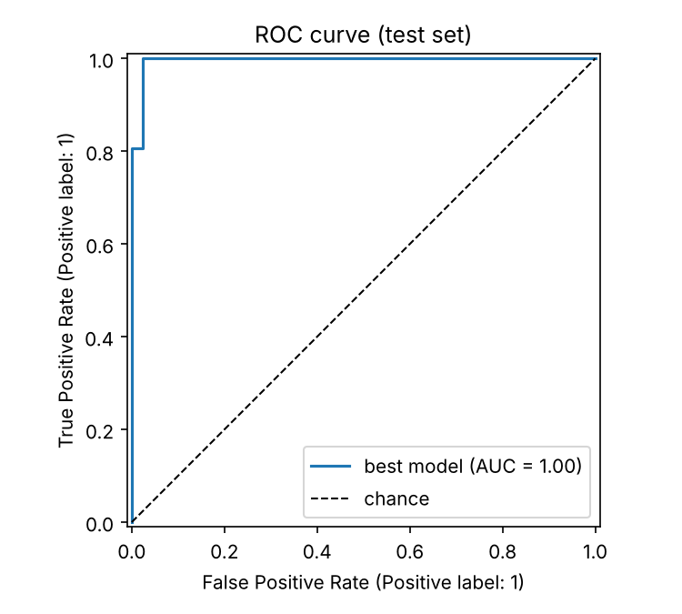
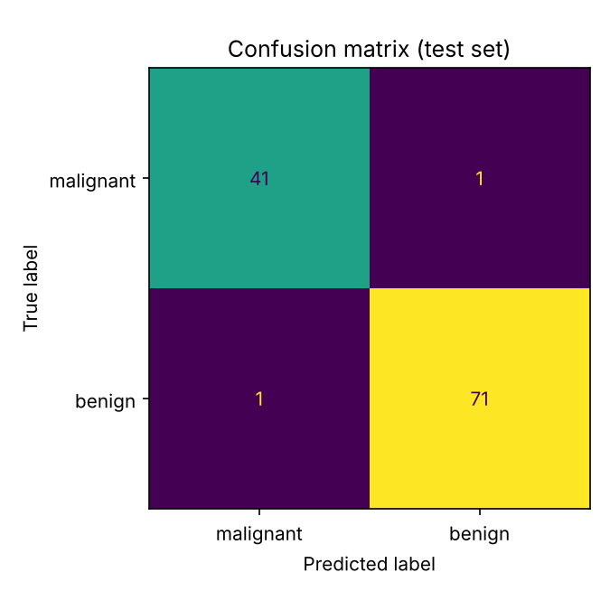
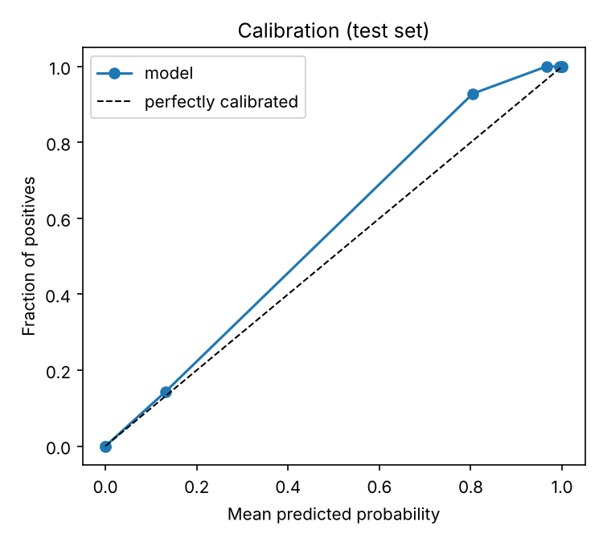

# diagml

[](https://github.com/YOUR_USERNAME/diagml/actions)


A reproducible, tested and deployable machine-learning pipeline for tabular diagnostic
classification (Wisconsin breast-cancer dataset, bundled with scikit-learn, so no downloads or API keys).

It goes beyond a notebook: config-driven experiments, leak-free cross-validated model selection,
uncertainty-aware evaluation, explainability, model provenance, a CLI, a REST API, tests, CI and Docker.

> **Disclaimer:** educational project. It is not a medical device and must not be used for clinical decisions.

## Results

Held-out test set (114 samples, stratified 80/20 split, seed 42):

| Metric | Value |
|---|---|
| ROC-AUC | **0.995** (95% bootstrap CI 0.983 to 1.000) |
| PR-AUC | 0.997 |
| Accuracy | 0.982 |
| Recall (benign) / Specificity | 0.986 / 0.976 |
| Brier score | 0.022 |

Model comparison (5-fold stratified CV ROC-AUC on the training set, randomized hyper-parameter search):

| Model | CV ROC-AUC (mean ± std) |
|---|---|
| **Logistic regression** (selected) | 0.9959 ± 0.0050 |
| Gradient boosting | 0.9933 ± 0.0048 |
| Random forest | 0.9908 ± 0.0063 |

The differences between models are within one standard deviation, so the simplest, most interpretable
model wins. Numbers are regenerated by `diagml train` and saved to `artifacts/metadata.json`.

<p align="center">
  
  
  
</p>

## Features

- **Config-driven** experiments (`configs/default.yaml`): seed, CV folds, search spaces, threshold.
- **No leakage:** scaling lives inside a scikit-learn `Pipeline`, fitted per CV fold.
- **Model selection** across three model families with `RandomizedSearchCV` and stratified K-fold.
- **Honest evaluation:** held-out test set, bootstrap confidence intervals, calibration curve, PR-AUC.
- **Explainability:** permutation importance on the test set (plot and CSV).
- **Provenance:** every model ships with `metadata.json` (data hash, params, metrics, library versions).
- **Input validation** on every prediction; clear errors for missing or unknown features.
- **FastAPI service** with `/health`, `/model`, `/predict`, `/predict/batch`, plus interactive docs at `/docs`.
- **Quality gates:** pytest suite, ruff, mypy, pre-commit, GitHub Actions matrix, Docker smoke test.

## Project layout

```
src/diagml/
  config.py    typed YAML config
  data.py      loading, stratified split, dataset fingerprint
  models.py    pipeline factories
  train.py     search, selection, evaluation, persistence
  evaluate.py  metrics, bootstrap CI, plots, permutation importance
  predict.py   validated inference wrapper
  api.py       FastAPI app
  cli.py       `diagml` command
configs/default.yaml
tests/
Dockerfile  Makefile  .github/workflows/ci.yml
```

## Quick start

```bash
git clone https://github.com/YOUR_USERNAME/diagml.git && cd diagml
python -m venv .venv && source .venv/bin/activate
pip install -e ".[api,dev]"

diagml train                       # ~30 s, writes ./artifacts
diagml sample --index 0 > rec.json # example input
diagml predict rec.json
diagml serve                       # http://127.0.0.1:8000/docs
```

Example request:

```bash
curl -X POST localhost:8000/predict -H 'content-type: application/json' \
  -d "{\"features\": $(diagml sample --index 0)}"
# {"label":0,"class_name":"malignant","probability_benign":0.0,"probability_malignant":1.0}
```

### Docker

```bash
docker build -t diagml . && docker run --rm -p 8000:8000 diagml
```

### Development

```bash
make test    # pytest with coverage
make lint    # ruff + mypy
```

## Design decisions

- **Why logistic regression wins:** on small, well-behaved tabular data a regularised linear model is
  hard to beat and is fast, calibrated and explainable. The pipeline still compares tree ensembles so the
  choice is evidence-based and re-evaluated whenever data or config change.
- **Selection vs. reporting:** model selection uses CV on the training split only; the test split is
  touched exactly once for reporting.
- **Permutation importance** values are small because many features are highly correlated: shuffling one
  leaves its correlated twins to carry the signal. Read the ranking, not the absolute magnitudes.

## Extending

Swap `data.py` for your own dataset (keep the `load_data()` contract), add a model in `models.py`
and a search space in `configs/default.yaml`. See [MODEL_CARD.md](MODEL_CARD.md) for intended use and limits.

## License

MIT
